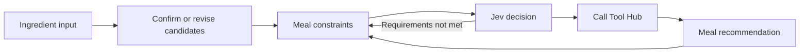

# Kyeongrak Choi | Software Developer · AI Agent Engineering

[한국어](README.md) | [English](README.en.md)

Software developer with experience building and operating Android, Flutter, and Spring-based services. I am currently expanding into AI agent and LLM application engineering through hands-on projects.

## About Me

- **10 years and 4 months** of experience building and operating mobile applications and backend systems.
- Experience with services connected to real operational data, including payment, ordering, ERP integration, production, and inventory management.
- Hands-on experience from feature delivery through deployment and production issue response.
- Currently building AI agent services with attention to state management, tool calls, safety, and failure handling.

## Featured Projects

### [PlanEat](https://github.com/Kyeongrak-Choi/PlanEat) | Conversational AI Meal Planning

PlanEat recommends meals from ingredients provided through fridge or receipt images and natural-language input. Ingredients inferred from images are not used immediately; only ingredients confirmed by the user are sent to the recommendation flow.

- Served as the **Backend / Agent Orchestrator** for an Encore AI Orchestration Engineer course team project
- Scope: FastAPI, LangGraph state transitions, session management, Jev decisions, guardrails, and result integration
- Jev is the decision layer that determines the next conversation step, such as whether ingredients are confirmed and constraints are sufficient
- Falls back to rule-based transitions when Jev returns low confidence or times out
- Production issue: adjusted the deployment path to use a single validated CSV source when PDF generation increased memory use

### [SubSync](https://github.com/Kyeongrak-Choi/Subsync) | YouTube-based English Learning Service

Responsible for the **AI Tutor backend and LLM provider fallback** in an Encore AI Orchestration Engineer course team project. Implemented video-context question answering, follow-up and proactive question flows, and a **Gemini → Groq → stub** fallback path for provider failures or usage limits.

- Contextual question answering based on the active video's subtitles and playback context
- Tutor flows for follow-up questions, proactive questions, and answer feedback
- FastAPI integration with Supabase and Redis; subtitles and user input are handled separately from system instructions as a prompt-injection defense

### [Jireummak](https://github.com/Kyeongrak-Choi/jireummak) | Impulse-purchase Prevention App

Solo Flutter app intended to reduce impulse spending. Users record an item's name, price, and purchase reason, then reconsider the decision after a 72-hour hold timer. Completed the project from product concept and UI/UX design through development, Google Play release, and operation.

- Key features: purchase-consideration records, 72-hour hold timer, and Google/Kakao sign-in
- Tech: Flutter, Firebase, Google Play Console
- [View on Google Play](https://play.google.com/store/apps/details?id=com.pause72.jireummak&hl=ko)

## Career & Learning

### Career Highlights

| Period | Experience |
| --- | --- |
| 2022.06 - 2024.02 | **Bonacamp** · Liquor-distribution apps and ERP integration |
| 2018.07 - 2021.12 | **Jincorporation** · Mobile POS |
| 2014.02 - 2018.04 | **Saehan Industrial** · Production, inventory, and ERP systems |
| 2012.12 - 2013.09 | **Neopoint** · Mobile OS and service development |

### Current Learning

Enrolled in Encore's AI Orchestration Engineer course (2026.08 - 2027.02). The program progresses from web-service and AI-backend fundamentals to single and multi-agent systems and service operations.

**Topics covered in the program**

- **Web and AI backend**: Python backend development, database integration, session management, and AI interface/UX design
- **Single-agent systems**: advanced prompting and reasoning, function calling, knowledge stores and long-term memory, and state-machine-based flow control
- **Multi-agent systems and operations**: multi-agent collaboration design, service deployment and automation, and AI security and guardrail design
- **Workflows**: no-code multi-agent workflow design, implementation, and operation

- [About the program](https://encorecampus.ai/orchestration)

### Links

- [AI Orchestration Labs](https://github.com/Kyeongrak-Choi/AI-Orchestration-Lab)
- [GitHub Pages Blog](https://kyeongrak-choi.github.io)
