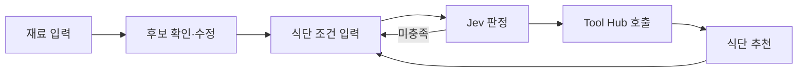

# 최경락 | Software Developer · AI Agent Engineering

[한국어](README.md) | [English](README.en.md)

Android·Flutter·Spring 기반 서비스 개발과 운영을 경험했으며, 현재는 AI Agent와 LLM 애플리케이션을 프로젝트로 구현하며 전문 영역을 확장하고 있습니다.

## About Me

- **10년 4개월** 동안 모바일 앱과 백엔드 시스템을 개발·운영했습니다.
- 결제·주문·ERP 연동, 생산·재고 관리처럼 현업 데이터와 연결되는 서비스를 다뤘습니다.
- 기능 구현에 그치지 않고 배포와 운영 이슈 대응까지 경험했습니다.
- 현재는 기존 서비스 개발 경험을 바탕으로, 상태 관리·도구 호출·안전성·장애 대응을 고려한 AI Agent 서비스를 만들고 있습니다.

## Featured Projects

### [PlanEat](https://github.com/Kyeongrak-Choi/PlanEat) | 대화형 AI 식단 추천

냉장고·영수증 이미지 또는 자연어로 받은 재료와 식단 조건을 바탕으로 식단을 추천하는 서비스입니다. 이미지에서 추정한 재료는 바로 추천에 쓰지 않고, 사용자가 확인해 확정한 재료만 추천 입력으로 사용합니다.

- 엔코아 AI Orchestration Engineer 과정 팀 프로젝트에서 **BE · Agent Orchestrator** 담당
- FastAPI, LangGraph 상태 전이, 세션 관리, Jev 판정, Guardrails, 결과 통합 구현
- Jev는 재료 확정 여부와 조건 충족 여부를 판정해 다음 대화 단계를 결정하는 계층
- Jev 판정의 confidence가 낮거나 timeout이 발생하면 규칙 기반 전이로 fallback
- 문제 해결: PDF 생성 중 메모리 사용량이 증가하는 배포 환경에서 CSV 단일 참조 경로로 조정

### [SubSync](https://github.com/Kyeongrak-Choi/Subsync) | YouTube 기반 영어 학습

엔코아 AI Orchestration Engineer 과정 팀 프로젝트에서 **AI Tutor 백엔드와 LLM Provider fallback**을 담당했습니다. 영상 자막·문맥 기반 질의응답과 후속·선제 질문 흐름을 구현하고, Gemini 장애·사용량 제한 시 **Groq → stub**으로 전환되는 구조를 만들었습니다.

- 현재 재생 중인 영상의 자막·문맥을 활용한 질의응답
- 후속 질문, 선제 질문, 답변 피드백을 포함한 Tutor 대화 흐름
- FastAPI, Supabase, Redis와 연동하고 자막·사용자 입력을 시스템 지시와 분리해 **프롬프트 인젝션 방어** 적용

### [지름막](https://github.com/Kyeongrak-Choi/jireummak) | 충동구매 방지 소비 습관 앱

충동구매를 줄이기 위한 Flutter 기반 개인 앱입니다. 사고 싶은 물건의 이름·가격·구매 이유를 기록한 뒤 72시간 보류 타이머로 다시 검토하도록 돕습니다. 콘셉트 기획, UI/UX 설계, 개발, Google Play 배포·운영까지 1인으로 진행했습니다.

- 주요 기능: 구매 고민 기록 관리, 72시간 보류 타이머, Google·카카오 간편 로그인
- 기술: Flutter, Firebase, Google Play Console
- [Google Play에서 보기](https://play.google.com/store/apps/details?id=com.pause72.jireummak&hl=ko)

## Career & Learning

### Career Highlights

| 기간 | 경험 |
| --- | --- |
| 2022.06 - 2024.02 | **보나캠프㈜** · 주류 유통 앱과 ERP 연동 |
| 2018.07 - 2021.12 | **㈜진코퍼레이션** · 모바일 POS |
| 2014.02 - 2018.04 | **㈜새한산업** · 생산·재고·ERP 시스템 |
| 2012.12 - 2013.09 | **㈜네오포인트** · 모바일 OS·서비스 개발 |

### Current Learning

엔코아 AI Orchestration Engineer 과정(2026.08 - 2027.01)을 수강하고 있습니다. 웹 서비스와 AI 백엔드 기초에서 시작해 단일·멀티 에이전트와 서비스 운영으로 확장하는 과정입니다.

**과정에서 다루는 주요 주제**

- **웹·AI 백엔드**: Python 백엔드 개발, DB 연동, 세션 관리, AI 인터페이스와 UX 설계
- **단일 에이전트**: 고급 프롬프트·추론 전략, Function Calling, 지식 저장소와 장기 기억, 상태 머신 기반 흐름 제어
- **멀티 에이전트·서비스 운영**: 멀티 에이전트 협업 설계, 서비스 배포와 자동화 운영, AI 보안과 가드레일 설계
- **워크플로우**: 노코드 멀티 에이전트 워크플로우 설계·구현·운영

- [과정 소개 보기](https://encorecampus.ai/orchestration)

### Links

- [AI Orchestration 학습·실습](https://github.com/Kyeongrak-Choi/AI-Orchestration-Lab)
- [GitHub Pages 블로그](https://kyeongrak-choi.github.io)
